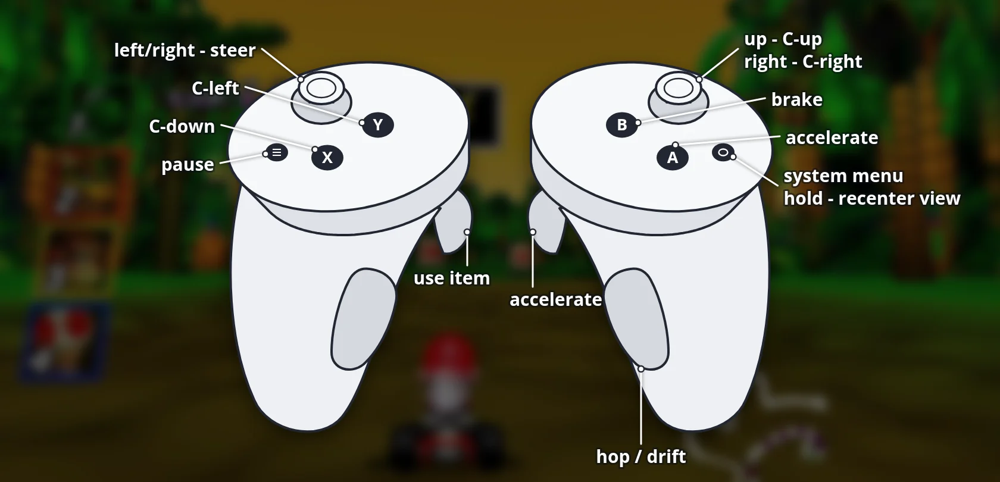

# SpaghettiKart-VR

A standalone headset build of Spaghetti Kart with stereoscopic 3D: the track is rendered for each eye with
head tracking, while the HUD and menus sit on a panel in front of you. Built on OpenXR, so one APK covers
Meta Horizon OS and PICO OS.

**Status: beta.** Developed and tested on Quest 3. PICO support is untested on hardware, see
[Known issues](#known-issues).

## What you need

- A Meta Quest 2, Pro, 3 or 3S with [developer mode](https://developers.meta.com/horizon/documentation/native/android/mobile-device-setup/) enabled,
  or a PICO 4, 4 Ultra or Neo 3 running PICO OS 5.9 or newer (which supports the standard OpenXR loader)
  with [developer mode](https://developer.picoxr.com/document/unity/test-and-build/) enabled
- A PC with `adb` (Android platform tools) and a USB-C cable
- Your own Mario Kart 64 (USA) ROM. The APK contains no game data; you extract it from your ROM on the PC.

## Install

1. Build the desktop version and extract the game data from your ROM, as described in
   [docs/BUILDING.md](../docs/BUILDING.md). Put the ROM in the repository root as `baserom.us.z64`
   (big-endian `.z64`; convert `.n64`/`.v64` dumps first), then run
   `cmake --build build-cmake --target ExtractAssets`. This produces `build-cmake/mk64.o2r` and
   `build-cmake/spaghetti.o2r`.
2. Connect the Quest and accept the USB debugging prompt inside the headset.
3. Run `android/deploy.sh`. It installs the APK and copies the game data to
   `/sdcard/Android/data/dev.spaghettikart.vr/files/` on the headset. Pass `--run` to start the game and
   show its log.
4. Start the game in the headset: on Quest under **Library → Unknown Sources → SpaghettiKart VR**, on PICO
   under **Library → Unknown Sources**.

To use a prebuilt APK instead of building one, pass its path: `APK=SpaghettiKart-VR-<version>.apk android/deploy.sh`.
The script also copies saves and settings over from the older Quest-only builds, which used a different
package name.

## Controls



PICO controllers use the same layout as Touch controllers.

| Controller | N64 | In game |
|---|---|---|
| Right trigger or A | A | Accelerate, confirm |
| B | B | Brake, back |
| Right grip | R | Hop, drift |
| Left trigger | Z | Use item |
| Left grip | L | |
| X / Y | C-down / C-left | |
| Left stick | Stick | Steer |
| Right stick | C buttons | |
| Menu | Start | Pause |

Hold the Meta button (Quest) or the PICO button to recenter the view and the menu panel.

## Settings

These are stored in `spaghettify.cfg.json` on the headset (under `CVars`) and can be edited there:

| Setting | Default | Meaning |
|---|---|---|
| `gVR.WorldScale` | 12 | Game units per meter. Higher makes the world feel smaller and the 3D effect weaker. |
| `gVR.HudAspectRatio` | 1.6 | Width of the HUD layout. Higher moves HUD elements further to the sides. |
| `gVR.PanelDistance` | 2.0 | Distance of the HUD and menu panel, in meters. |
| `gVR.PanelWidth` | 2.4 | Width of the 4:3 part of the panel, in meters. |
| `gVR.ResolutionScale` | 1.0 | Per-eye render resolution relative to the headset's recommendation. |

## Building the APK

Requirements: Android SDK with NDK 27.2.12479018 and CMake 3.31.6, JDK 17, and the repository submodules
(`git submodule update --init`).

```sh
cd android
./gradlew assembleRelease
```

The APK is written to `app/build/outputs/apk/release/app-release.apk`. It is signed with your local debug
key, which is fine for sideloading.

The VR rendering hooks in libultraship are kept in `patches/libultraship-vr-stereo.patch`; the build applies
it to the submodule automatically if it isn't applied yet.

## Known issues

- **PICO is untested.** The manifest entries and the PICO controller profiles
  (`XR_BD_controller_interaction`) are in place, but nothing has been verified on a PICO headset. The most
  likely problems are the controller bindings and the runtime refusing an unsupported binding path; the log
  in `files/logs/` reports which interaction profiles the runtime accepted.
- Split-screen multiplayer is disabled in VR; only single player can be selected.
- Clouds, stars and snow aren't shown in VR. Lightning flashes appear on the menu panel instead of across the view.
- The in-game settings menu (ImGui) isn't available in VR.
- Frame rate can drop below 72 FPS during busy races, because the renderer runs on the CPU for both eyes.
- The camera follows the kart's pitch and roll, which may be uncomfortable for some players.
